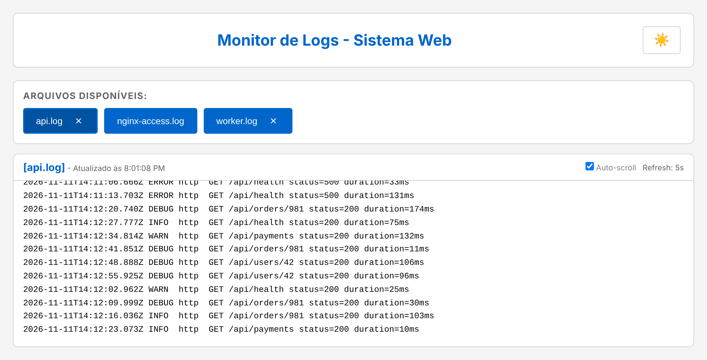

# log-viewer

[](https://github.com/lcmuniz/log-viewer/actions/workflows/ci.yml)
[](LICENSE)

A small, dependency-free Go tool that serves a local web UI to follow the log
files of a folder in real time — handy when running several services on your
machine and you don't want a terminal per `tail -f`.



## Features

- Tabs to follow several files at once, with configurable auto-refresh and auto-scroll
- Shows `.log`, `.txt` and extension-less files of the chosen folder
- Only the tail of large files is sent (1 MiB by default, configurable)
- Light / dark theme
- Single static binary: the UI is embedded with `go:embed`, no runtime dependencies

## Install

Requires Go 1.24+.

```bash
go install github.com/lcmuniz/log-viewer/cmd/log-viewer@latest
```

or from a clone:

```bash
make build   # binary in bin/log-viewer
```

## Usage

```bash
log-viewer -l ~/my-app/logs
```

The browser opens at <http://127.0.0.1:3000>.

| Flag | Default | Description |
|------|---------|-------------|
| `-l` | `.` | Folder with the log files |
| `-r` | `5` | Refresh interval in seconds |
| `-t` | `light` | Theme: `light` or `dark` |
| `-addr` | `127.0.0.1:3000` | Listen address |
| `-max-bytes` | `1048576` | Maximum bytes shown from the end of each file |
| `-no-browser` | `false` | Don't open the browser automatically |

`-r` and `-t` are saved in `log-viewer.json` inside the log folder, so the next
run reuses them.

## Security

log-viewer is meant for **local development**. It has no authentication, so:

- By default it listens on `127.0.0.1` only. Binding to `0.0.0.0` exposes your
  logs to anyone on the network, and the tool prints a warning when you do it.
- Only regular files placed **directly** in the folder are served. Sub-folders,
  `..` paths, symlinks, dot-files (e.g. `.env`) and other extensions are refused.
- On loopback, requests whose `Host` header isn't `localhost`/`127.0.0.1`/`::1`
  are rejected, which blocks DNS-rebinding attacks from malicious web pages.
- Responses carry a strict Content-Security-Policy and file names / contents are
  always rendered as text, never as HTML.

## Development

```bash
make test   # go test -race ./...
make lint   # gofmt + go vet
make run
```

Project layout:

```
cmd/log-viewer/      CLI flags, HTTP server, graceful shutdown
internal/viewer/     HTTP handlers, file access rules, config, embedded UI (static/)
```

CI runs vet, tests (with the race detector) and a build on Linux, macOS and Windows.

## Resumo em português

Ferramenta em Go que abre uma interface web local para acompanhar, em tempo
real, os arquivos de log de uma pasta (`log-viewer -l ~/minha-app/logs`). Por
padrão escuta só em `127.0.0.1:3000`, não tem autenticação e serve apenas
arquivos `.log`, `.txt` ou sem extensão que estejam diretamente na pasta.

## License

[MIT](LICENSE)
